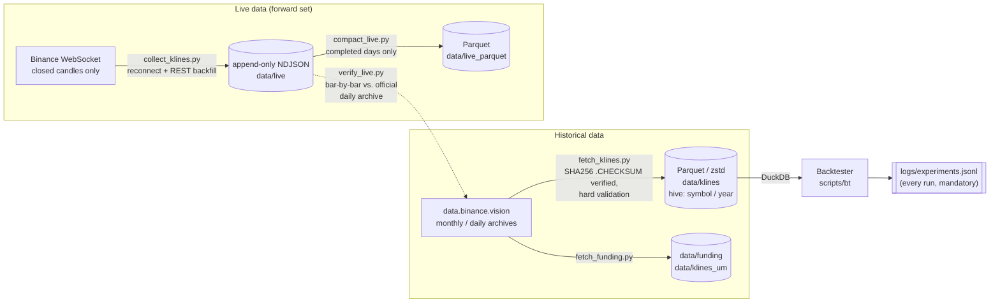

# marketdata-pipeline

A crypto market-data pipeline and backtesting framework, built as a **learning
project**.

This repository does **not** contain a profitable trading strategy and makes no
claim that one exists. The goal is the infrastructure around one: clean,
verified data, and a backtester that makes it hard to fool yourself.

Project notes in `DATA.md`, `GAPS.md`, `SPLITS.md` and in code comments are
written in German.

## Architecture



### Data pipeline

- **`fetch_klines.py`**: bulk-downloads spot klines from `data.binance.vision`.
  Each archive is checked against its published `.CHECKSUM` (SHA256). Parsing
  handles optional headers and ms/µs timestamps. Validation fails hard on
  duplicates, non-monotonic time, inconsistent OHLC, non-positive prices, NaNs,
  or more than 2 % missing bars, before anything is written.
- **`fetch_funding.py`**: funding rates and USDT-M perpetual klines, using the
  same verification path.
- **`collect_klines.py`**: WebSocket collector. It writes **only closed
  candles**, since writing open candles would be lookahead bias. After every
  reconnect, and on restart, it backfills the gap via REST. It writes
  append-only NDJSON with `fsync`, and records each bar's origin (`ws` or
  `rest_backfill`). It can optionally send a heartbeat to a push monitor
  (`KUMA_PUSH_URL`).
- **`compact_live.py`**: compacts completed **UTC** days of NDJSON to Parquet.
  The running UTC day is never compacted. The NDJSON stays the source of
  truth; Parquet is derived and can be rebuilt.
- **`verify_live.py`**: compares a collected day bar by bar against Binance's
  official daily archive (missing bars, phantom bars, OHLCV differences).
- **`gaps.sql`**: DuckDB query that lists gaps in the historical store.

### Backtester (`scripts/bt`)

- **Event-driven loop, long-only spot.** It is deliberately not vectorized: a
  bar-by-bar loop can't read data that doesn't exist yet. A signal computed on
  bar *t* is executed at the **open of *t+1***. This shift happens once, inside
  the engine, so no strategy can forget it.
- **Realistic costs.** Fee plus slippage are charged on the notional of every
  position change. The defaults are 10 bps fee (Binance spot taker) and 5 bps
  slippage.
- **Session-aware gap handling.** Every gap in the time grid starts a new
  session, and rolling windows never span a session boundary. Positions *are*
  held through exchange outages, because exiting early would require knowing
  the outage was coming. Trades that span a gap are flagged (`spans_gap`), and
  their P&L share is reported (`gap_pnl_share`). See [GAPS.md](GAPS.md).
- **Mandatory experiment log.** Every run, including failed ones, is appended
  to `logs/experiments.jsonl` with its config hash, metrics and a free-text
  note. Logging can't be turned off.
- **Random-entry null baseline.** Each strategy is compared with 1000 runs that
  use random entries but the same number of trades and the same holding-period
  distribution. The run reports the strategy's percentile in that
  distribution.
- **Locked holdout.** The split boundaries are hard-coded in `bt/data.py`.
  Loading the holdout requires an explicit `--i-am-done`, and every use is
  counted in `logs/holdout_uses.jsonl`. `--from` / `--to` can only *narrow* a
  split, never extend it into the holdout. See [SPLITS.md](SPLITS.md).
- **Metrics.** Sharpe and Sortino are computed on *daily* returns, not minute
  returns. The run also reports drawdown, Calmar, exposure, costs paid, win
  rate, profit factor, and how much of the gross profit the top 5 trades
  contributed.

## Control tests

Before any strategy idea is worth looking at, the engine has to pass three
controls. Values are taken from `logs/experiments.jsonl`. All three runs use
BTCUSDT on 1h bars over the exploration split (2019-01-01 to 2023-12-31, about
5.0 years), with 10 bps fee and 5 bps slippage.

| Control | Purpose | Total return | CAGR | Sharpe (daily) | Max DD | Exposure | Trades |
|---|---|---:|---:|---:|---:|---:|---:|
| `buy_and_hold` | Reference point | +1,041 % | +62.8 % | 1.06 | −77.2 % | 100 % | 0¹ |
| `always_flat` | Null case | 0.0 % | 0.0 % | 0.00 | 0.0 % | 0 % | 0 |
| `oracle` | Engine check (looks ahead) | ≈ 7.1 × 10²⁵ ײ | ≈ 1.5 × 10⁷ % | 15.29 | −11.3 % | 51.0 % | 11,778 |

¹ The single buy is never closed, so no completed trade is logged. Costs paid
were 0.15 % of initial capital (one entry).
² The total return is a multiple of initial capital, not a percentage.

**Why `oracle` has to be absurdly high.** The oracle is long during a bar
exactly when that bar's open-to-open move is positive. In other words, it knows
the future. Compounding thousands of guaranteed winning bars must produce
astronomical numbers. If it doesn't, the engine is broken: signals are executed
late, costs are double-counted, or equity is computed incorrectly. A believable
oracle result would be the alarming outcome.

The details also tell you something:

- The win rate is 64.3 %, not 100 %, because the round trip costs about 30 bps.
  Moves the oracle "correctly" predicts but that are smaller than the costs
  become net losers. This confirms that costs are applied.
- Max drawdown is not zero, because equity is marked at the close while the
  oracle only knows open-to-open moves.
- `always_flat` must return exactly zero with zero cost, and it does.

One further reference run in the log isolates 2022 with buy-and-hold: −64.6 %,
Sharpe −1.34, max DD −67.4 %. That bear market sits inside the exploration
period.

## Methodology / avoiding self-deception

- **Overfitting.** Any rule you tune long enough on the same data will look
  good. The defence is structural, not willpower. The data is split into
  **exploration** (2019-01-01 to 2023-12-31, where all research happens),
  **holdout** (2024-01-01 to 2026-08-20, used *once*, for *one* final
  strategy), and **forward** (live collector data from 2026-08-21, the only
  data that is out of sample by construction). Holdout and forward don't
  overlap.
  The holdout sits at the *end* of the series on purpose: markets are not
  stationary, and the question is whether a rule holds in the most recent
  regime.
- **Holdout discipline.** After the first use, the holdout no longer counts as
  independent evidence. The use counter makes it visible if that has happened.
- **Null baseline instead of "beats buy-and-hold".** Beating buy-and-hold says
  little when exposure and timing differ. The random-entry baseline holds
  everything constant except *when* you enter. A strategy below the 95th
  percentile of that distribution has found nothing.
- **Multiple testing.** The best of *N* variants is biased upward, and the bias
  grows with *N*. That is why every run is logged and the runner prints the
  current count after each run. Past 20 logged variants, landing in the 95th
  percentile of the null distribution means nothing; you'd expect it from
  chance. The current log has **4 runs**, and all of them are controls or
  reference runs (buy-and-hold, flat, oracle, buy-and-hold 2022). **No strategy
  hypothesis has been tested yet.**
- **Gaps are not noise.** Binance outages cluster in high-volatility moments,
  for example the COVID crash and the April 2021 flash crash. A backtest that
  silently interpolates over them overstates what you could actually have
  traded. See [GAPS.md](GAPS.md).

## Quick start

Requires Python 3.10+.

```bash
python -m venv .venv && source .venv/bin/activate
pip install -r requirements.txt

# historical data (written to data/klines)
python scripts/fetch_klines.py --symbol BTCUSDT --interval 1m --start 2019-01

# control runs
python scripts/run_backtest.py --strategy buy_and_hold --tf 1h --no-baseline --note "reference"
python scripts/run_backtest.py --strategy oracle       --tf 1h --no-baseline --note "engine check"

# a real (example) strategy, with the random-entry baseline
python scripts/run_backtest.py --strategy sma_cross --tf 15min \
    --param fast=20 --param slow=100 --note "why am I running this?"

# live collector + verification
python scripts/collect_klines.py --symbols BTCUSDT ETHUSDT --interval 1m
python scripts/compact_live.py --symbol BTCUSDT
python scripts/verify_live.py  --symbol BTCUSDT --date 2026-08-21
```

All data is written below `data/`, which is git-ignored. All timestamps are
UTC.

### Tests

The tests use synthetic fixtures and need no downloaded data and no network.

```bash
pip install -r requirements-dev.txt
python -m pytest tests
```

## Directory layout

```
.
├── scripts/
│   ├── fetch_klines.py      historical spot klines (checksum-verified)
│   ├── fetch_funding.py     funding rates + perp klines
│   ├── collect_klines.py    WebSocket live collector
│   ├── compact_live.py      NDJSON -> Parquet (completed days)
│   ├── verify_live.py       live data vs. official archive
│   ├── run_backtest.py      backtest runner (logs every run)
│   ├── gaps.sql             gap listing (DuckDB)
│   └── bt/
│       ├── data.py          loading, resampling, sessions, split guard
│       ├── engine.py        event-driven engine, costs
│       ├── metrics.py       metrics on daily returns
│       ├── baseline.py      random-entry null distribution
│       └── strategies.py    controls + example strategy
├── tests/                   pytest, synthetic fixtures only
├── systemd/                 example units (see Deployment)
├── logs/experiments.jsonl   experiment log (committed)
├── data/                    not committed
├── DATA.md                  dataset inventory
├── GAPS.md                  gap analysis
└── SPLITS.md                frozen data splits
```

## Deployment

In production the pipeline runs in an LXC container under systemd. The
`systemd/` directory contains **example** units for the live collector and the
daily compaction. They assume an install in `/opt/marketdata` with a venv in
`.venv` and a dedicated `marketdata` user; adjust those to your setup. All
units set `TZ=UTC`.

```bash
sudo cp systemd/*.service systemd/*.timer /etc/systemd/system/
sudo systemctl daemon-reload
sudo systemctl enable --now marketdata-collector.service marketdata-compact.timer
```

## Further documentation

- [DATA.md](DATA.md): dataset inventory and live-collector verification
- [GAPS.md](GAPS.md): gaps in the BTCUSDT history and how the backtester handles them
- [SPLITS.md](SPLITS.md): frozen exploration / holdout / forward splits

## License

MIT, see [LICENSE](LICENSE).
