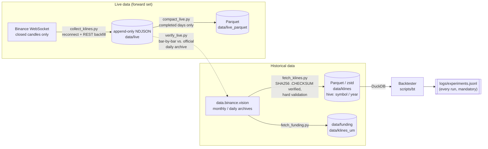

# marketdata-pipeline

A crypto market-data pipeline and backtesting framework, built as a **learning
project**.

This repository does **not** contain a profitable trading strategy and makes no
claim that one exists. The goal is the infrastructure around one: clean,
verified data, and a backtester that makes it hard to fool yourself.

Project notes in `DATA.md`, `GAPS.md`, `SPLITS.md` and in code comments are
written in German.

## Architecture



### Data pipeline

- **`fetch_klines.py`**: bulk-downloads spot klines from `data.binance.vision`.
  Each archive is checked against its published `.CHECKSUM` (SHA256). Parsing
  handles optional headers and ms/µs timestamps. Validation fails hard on
  duplicates, non-monotonic time, inconsistent OHLC, non-positive prices, NaNs,
  or more than 2 % missing bars, before anything is written. Only **completed
  UTC months** are stored. The running month is skipped and gets fetched from
  the monthly archive on the first run after the month has ended.
- **`fetch_funding.py`**: funding rates and USDT-M perpetual klines, using the
  same verification path.
- **`collect_klines.py`**: WebSocket collector. It writes **only closed
  candles**, since writing open candles would be lookahead bias. After every
  reconnect, and on restart, it backfills the gap via REST. It writes
  append-only NDJSON with `fsync`, and records each bar's origin (`ws` or
  `rest_backfill`). It can optionally send a heartbeat to a push monitor
  (`KUMA_PUSH_URL`).
- **`compact_live.py`**: compacts completed **UTC** days of NDJSON to Parquet.
  The running UTC day is never compacted. The NDJSON stays the source of
  truth; Parquet is derived and can be rebuilt.
- **`verify_live.py`**: compares a collected day bar by bar against Binance's
  official daily archive (missing bars, phantom bars, OHLCV differences).
- **`gaps.sql`**: DuckDB query that lists gaps in the historical store.
- **`fetch_dukascopy.py`**: historical 1-minute bars with **bid and ask** OHLC
  for XAUUSD, XAGUSD and EURUSD from Dukascopy (daily 1-minute candle files by
  default, hourly tick files optionally). See
  [Dukascopy (metals / FX)](#dukascopy-metals--fx) below.
- **`fetch_calendar.py`**: economic calendar (US / euro area) for the news
  blackout of a gold/silver bot. See
  [Economic calendar](#economic-calendar) below.
- **`export_fixture.py`**: exports a small slice of the kline store (default
  BTCUSDT 1m, 2024-01-01 to 2024-01-07) as a gzip CSV test fixture under
  `tests/fixtures/`. Meant to be run where the data lives; the output is then
  committed.

### Dukascopy (metals / FX)

`fetch_dukascopy.py` reads `datafeed.dukascopy.com` (URL month is **0-based**,
January = `00`; all times UTC). Files are LZMA-compressed; an empty file means
no data, a 404 means missing.

Two modes (`--mode`):

- **`candles` (default)**: one file per day and side,
  `{SYM}/{YYYY}/{MM0}/{DD}/{BID|ASK}_candles_min_1.bi5`, 24-byte big-endian
  records (uint32 seconds since 00:00 UTC, four uint32 prices, float32
  volume). Two requests per day instead of 24 (~12x fewer). BID and ASK are
  merged into the same schema as the tick mode. Minutes where **both** sides
  have volume 0 and flat prices are fill candles and are dropped.
  `tick_count` is **1** for every kept minute (not a real tick count).
- **`ticks`**: hourly `{HH}h_ticks.bi5`, 20-byte records (`>3I2f`: ms since
  the hour, ask, bid, ask volume, bid volume), aggregated to 1-minute bars.

The candle format is taken from `dukascopy-node` 1.46.4 (the last version that
used the bi5 datafeed; line references in `DATA.md` and the script docstring)
and was **not verified live**. The order of the four price fields is
disputed (`dukascopy-node`: open, close, low, high; another source: open, high,
low, close), so it is **determined per file from the data**: an order fits
if `high >= max(open, close)` and `low <= min(open, close)` for every non-flat
candle. Exactly one fits: used. Both fit (only possible if `close == high` in
every active candle, where both readings give identical values): used,
reported as `ambiguous`. **None fits: the file goes to quarantine**
(`<name>.quarantine`, not cached, not retried), the month is not written, the
run report lists it under `quarantine`, and the exit code is **4** (manual
check needed). Check the format against ticks on the target machine with:

```bash
python scripts/fetch_dukascopy.py --symbol XAUUSD --verify-day 2024-03-06
```

It loads the day's 24 tick files and both candle files, aggregates the ticks to
minutes and compares OHLC per side (detected field order, minutes only in one
source, max deviation in points, volumes). Exit 0 = match, 4 = deviation above
`--verify-tol` (points, default 0.5) / `--verify-max-share` (default 0) or a
quarantined file, 3 = download failed. Report:
`metals/reports/SYM-verify-YYYY-MM-DD.json`. Delete a `.quarantine` file to
have it downloaded again.

Fault tolerance and throttling:

- A file that still fails after `--attempts` (5) does **not** stop the run:
  it is collected, the run continues, and all failures are retried at the end
  in `--final-retries` rounds (2), each after `--final-wait` seconds (300).
- A monthly file is written **only if the month is complete**: no unresolved
  failures, no unconfirmed "no data" answers, no quarantined files. The next
  run fetches only the missing files and then writes the month.
- "No data" (404 or an empty 200 response) is cached as a marker
  (`<name>.404` / `<name>.empty`, JSON with `first_seen` and `confirmed`),
  never as a 0-byte raw file. On weekends, Dec 25 and Jan 1 it is final at
  once. **On weekdays it is unconfirmed** (a gap, exit 3) until a request at
  least 24 h later again returns no data (in tick mode this applies to 404
  only; empty weekday hours are normal). A candle day with data on one side
  only is treated the same way. Candle files are requested only 6 h after the
  end of the day, months only 6 h after month end.
- Corrupt cache files (LZMA error, 0 bytes) are moved aside as `<name>.corrupt`
  and downloaded again. Validation errors are collected per month; the other
  months continue and the run exits 2 at the end.
- The run report `metals/reports/SYM-dukascopy-run.json` is **always** written
  (also on gaps, SIGTERM or validation errors): summary, `gaps` (symbol, month,
  file, day/hour/side, URL, HTTP status, last error, attempts),
  `unconfirmed`, `quarantine` and `validation_errors`. The next run reads it
  and tries the gap files first.
- `--workers` (default 1), `--pause` (1.0 s between requests per worker), one
  `requests.Session` (keep-alive) per worker, separate `--connect-timeout`
  (10 s) / `--read-timeout` (60 s). Every throttling or error response
  (403/408/425/429/5xx, timeouts, connection errors) increments a counter `k`
  shared by **all** workers and across files and sets a global cooldown of
  `--backoff-base` (2 s) x 2^k with jitter, capped at `--max-backoff` (600 s);
  `Retry-After` is honoured up to the cap; the counter resets only on 200/404.
  After `--max-consecutive-failures` (20) failures in a row the run stops
  cleanly (report, exit 3) and leaves the restart to systemd.
- HTTP 403 is most likely the datafeed's WAF/bot protection (newer
  `dukascopy-node` versions moved to a different API for that reason). It is
  retried like 503, never treated as "no data", counted separately in the
  report, and if most requests of a run get a 403 the log and report say so
  (raise `--pause`, try later).
- Progress (files done/total, rate, ETA) every `--progress-every` (50)
  downloaded files; cache hits do not count as requests.
- A per-symbol lock (`flock` on `metals/.lock-SYM`) prevents two processes
  (e.g. a history service and a monthly timer) from working on the same
  symbol; the second one exits 3 at once without touching reports.
- SIGTERM/SIGINT: no new downloads, running ones finish, the report is
  written, exit 3 if anything is left. A restart continues without duplicate
  work; finished months are skipped. Use `TimeoutStopSec` above the read
  timeout (e.g. 120 s).
- Exit codes (in this order of precedence): **2** validation error (no
  restart), **3** gaps: failed downloads, unconfirmed "no data", interrupted,
  circuit breaker or lock busy (restart later is fine), **4** manual check
  needed: quarantined file or `--verify-day` mismatch (no restart), **0**
  complete. Exit 3 deliberately wins over 4: the units restart on 3 but not
  on 4, so returning 4 while gaps remain would stop the backfill. A
  quarantine is still hard to miss: the run report `status` reads e.g.
  `gaps+quarantine`, a top-level `quarantined` list names the months, and
  every run logs an ERROR line while it lasts.

Store and validation:

- Raw files are cached (month 1-based in the cache path), so the store can be
  rebuilt (`--rebuild`) without downloading again; delete a marker to request
  that file again. All files are written atomically (hidden
  `.name.pid.thread.part` temp file, which pyarrow ignores, fsync of file and
  directory, `os.replace`); orphaned temp files are removed at start.
- Bars cover `[t, t+1min)`, labelled left, and exist only for minutes with
  trading (no filling). Only **completed UTC months** are written (so no
  candle file of the running day is ever requested); existing monthly files
  are not overwritten unless `--rebuild` is given. Parquet schema metadata
  `dukascopy_mode` and the monthly report field `mode` record the mode.
- **Assumption, to be verified:** price = integer / `POINT_DIVISOR`, with
  1000 for XAUUSD/XAGUSD and 100000 for EURUSD. A wrong divisor shifts prices
  by powers of ten, so every bar is checked against a coarse plausible range
  (XAUUSD 200–20000, XAGUSD 3–500, EURUSD 0.5–2.0) and a yearly price anchor,
  and the run aborts hard instead of writing wrong prices.
- Hard validation before writing (the month is not written): duplicates, monotonic time, bid and ask OHLC
  consistency, prices > 0, NaNs, plausible range, crossed quotes
  (`ask_close < bid_close`, abort above 0.1 % of bars). Soft checks are only
  reported (log + JSON under `metals/reports/`): spread outliers (> 20x the
  monthly median), 1m mid jumps > 2 %, minutes without ticks Mon–Fri on a
  coarse grid, and continuity (`|open[t+1] - close[t]|` in points). There is
  deliberately **no hard gap limit** as for crypto: metals and FX have daily
  breaks and weekends. Classifying gaps as planned or unplanned is left to the
  consumer's trading calendar.
- Data root: `MARKETDATA_DATA_ROOT`, default `data/` in the repo (read only
  by this script and `fetch_calendar.py`).
- **License:** check Dukascopy's terms of use yourself. Do not redistribute
  or commit the data, raw or derived (`data/` is git-ignored).

### HistData (metals / FX, default source)

`fetch_histdata.py` is the **default source** for XAUUSD, XAGUSD and EURUSD.
Dukascopy answers HTTP 429 per client IP in the homelab, even with one
worker. The output is the same as the Dukascopy store (columns, dtypes,
atomic writes, reports, exit codes). The bot can tell the two sources apart
only by the partition `metals/source=histdata/...`. Research, sources and
open points (German): [docs/histdata_research.md](docs/histdata_research.md).

Download: GET the period page
`https://www.histdata.com/download-free-forex-historical-data/?/ascii/{tick-data-quotes|1-minute-bar-quotes}/{sym}/{YYYY}[/{M}]`,
read the hidden form `file_down` (`tk`, `date`, `datemonth`, `platform`,
`timeframe`, `fxpair`), then POST it to `https://www.histdata.com/get.php`
with that page as `Referer`. The response is a ZIP with one CSV and a status
`.txt` (gap list). An empty body means no data. **Every file costs 2
requests**, and only one request runs at a time.

Two modes (`--mode`):

- **`tick` (default)**: Generic ASCII ticks `YYYYMMDD HHMMSSmmm,bid,ask,volume`,
  one ZIP per month, aggregated to 1-minute bid **and** ask OHLC with a real
  `tick_count`. This is the only HistData format that has the ask side, so
  it is the only one that keeps the spread. Parquet metadata:
  `histdata_mode=histdata_tick`, `spread_available=true`.
- **`m1`**: Generic ASCII 1-minute bars `YYYYMMDD HHMMSS;o;h;l;c;v`, **bid
  only**. Past years come as one yearly ZIP, the current year monthly.
  - It writes to its **own partition** `metals/source=histdata_m1/...`, so
    bid-only months never mix with tick months; the bot reads only
    `source=histdata` and `source=dukascopy`.
  - The store gets `ask_* = bid_*` (spread 0) and `tick_count = 1`. The
    metadata says `histdata_mode=histdata_m1`, `spread_available=false`, and
    the bot's cost model must supply the spread.
  - A monthly file whose `histdata_mode` differs from the current mode is
    never overwritten, not even with `--rebuild` (`store_mode_conflict`,
    exit 4).
  - Exact duplicate minutes are dropped; conflicting duplicates (observed in
    real HistData M1 files) are merged and counted in the monthly report.

Time zone:

- **Tick timestamps are New York local time with daylight saving**
  (`America/New_York`: UTC-5 in winter, UTC-4 in summer), although HistData
  documents "EST without daylight saving". This was measured in the homelab
  on real XAUUSD ticks: in 2024-07 every one of the 38 anchors sat at -4 h
  (daily break 16:59:58 -> 18:00:01, weekly close Friday 16:59:58, weekly
  open Sunday 18:00:01, which are exactly the New York session times);
  2024-01 sat at -5 h.
- **M1 keeps the documented fixed UTC-5** (`Etc/GMT+5`). This is **not
  verified** for M1. Check it with
  `--mode m1 --verify-month 2024-07` before relying on M1 summer months.
- The zones live in `RAW_TZ = {"tick": "America/New_York", "m1": "Etc/GMT+5"}`.
  `raw_to_utc_ms` reads the raw digits as wall-clock time in that zone and
  converts them exactly to UTC (vectorized). A local time that does not
  exist (spring-forward gap, e.g. 2024-03-10 02:00–02:59:59.999) or is
  ambiguous (fall-back hour, e.g. 2024-11-03 01:00–01:59:59.999) is never
  guessed. The market is closed then, so such a tick raises `TimezoneError`
  and the raw month goes to quarantine (exit 4).
- A UTC month M therefore needs raw months M-1 (its last 4 hours in EDT, 5
  hours in EST) and M; the raw months are computed from `RAW_TZ`. M is
  written only when both are present, or when M-1 is before the symbol's
  history or confirmed empty.
- The time zone is **checked in code for every raw month**. Every market gap
  gives a close anchor and an open anchor:
  - weekend (gap of 24 h or more): close Friday 17:00 New York, open Sunday
    18:00 for metals, 17:00 for EURUSD;
  - for metals, the daily break (Mon–Thu, 17:00–18:00 New York): at most
    one per day (the longest), only if its offset is unambiguous and within
    3 h of the expected one. Thin markets such as silver have other gaps,
    and those are ignored.

  The last tick of the previous cached raw month and the first ticks of the
  next one are added, so the weekend across the month edge is an anchor
  too (EURUSD has no daily break and otherwise had no anchor there).
  Expected market times come from `zoneinfo` `America/New_York`. The
  expected offset is taken per anchor from `RAW_TZ[mode]` at that moment
  (tick: -4 h in EDT, -5 h in EST; m1: always -5 h). Decisions use the
  **deviation** = implied minus expected. A gap's deviation is estimated
  from both sides together: the close may not lie before the last tick and
  the open not after the first tick. This stays correct for thin data,
  where the ticks are minutes away from 17:00/18:00. Ambiguous gaps do not
  count. An anchor is **reliable** when its gap gives a unique deviation,
  when the two sides of a weekend contradict each other, or when both
  ticks sit within 2 minutes of the event while the market is active
  around them.
- The month passes only if all of these hold:
  - at least 3 anchors
  - median deviation 0
  - at least 60 % of anchors with deviation 0
  - no run of 3 consecutive gaps with the same non-zero deviation (that
    means a shift in mid-month)
  - **no reliable anchor with a deviation of exactly 1 h in the first or
    last 72 h** of the raw month (a clock change at the month edge; holiday
    early closes are off by 2 h or more and stay allowed)
  - for zones with DST (tick): **no reliable anchor with any deviation
    within 7 days of a New York clock change** (data stamped with another
    DST rule, such as the EU rule or the US rule before 2007)
  - no weekend across which the reliable deviation jumps by exactly 1 h
  - no timestamp jumps back by 30 minutes or more in file order (that means
    a clock change)
- Tested on synthetic data for 2001–2026: correct New York stamping passes
  every month; EU-rule and pre-2007-rule stamping never ends up in a
  written UTC month (XAUUSD and EURUSD). Thin silver (about one tick per
  20 minutes) passes every month and shifted stamping is never written.
  Limit: EURUSD (weekend anchors only) at about one tick per 20 minutes
  around the Sunday open can miss a shift that lasts one week; real EURUSD
  ticks are dense. At about one tick per 50 minutes most months fail and
  go to quarantine.
- If the following raw month M+1 is cached and starts 1 h off, month M is
  not written either: the switch probably happened after M's last anchor.
  M+1 is fetched first whenever UTC month M+1 is due anyway, so this costs
  no extra requests.
- A month with too few anchors, such as a short first month of the
  history, is checked together with its cached neighbouring raw months. If
  it still can't be checked, it goes to quarantine as "NICHT PRUEFBAR".
- Otherwise the raw month goes to **quarantine** (`<zip>.quarantine` with the
  full check, exit 4). Nothing shifted is ever written.
  - Deleting the marker re-checks the month without a download.
  - Deleting the ZIP downloads it again; the new download removes the
    marker and the month is checked again.
  - Setting `"accepted": true` in the marker releases the month after a
    manual check.
  - Markers carry `raw_tz` and `tz_check_version`. A marker that is not
    released and comes from an older check version or another zone is
    removed with a WARNING and the raw month is re-checked without a
    download.
  - `"accepted": true` holds only for the same conversion (`raw_tz`). A
    release made under another conversion (the old fixed-UTC-5 check, no
    `raw_tz`) is re-checked: if the month passes, the marker is removed;
    if not, it is rewritten with `"accepted": false` and a note that the
    earlier release applied to the old conversion. A tick at an ambiguous or
    nonexistent local time blocks even a released month.
  - An unreadable marker (invalid JSON, e.g. a typo while setting
    `"accepted": true`) is kept, logged as ERROR and keeps blocking.
- Monthly files carry the parquet metadata `source_timezone`, derived from
  `RAW_TZ` and the check version, e.g.
  `America/New_York -> UTC, je Rohmonat geprueft (tz_check v3)`. At the start
  of **every** run, all monthly files of the symbol and mode are checked,
  not only those in `--start`/`--end`:
  - same conversion zone, old label only (e.g. m1 files of the previous
    version): the metadata is rewritten, the file is never moved, no
    requests (`relabelled_timezone` in the run report);
  - different conversion that shifts UTC times in this month (tick months
    touching EDT, written by the fixed-UTC-5 code, 1 h off): the file is
    **moved to `metals/stale/` at once**, so the bot sees a gap rather than a
    shifted month. Outside the range it is listed under
    `stale_retired_out_of_range`;
  - different conversion but identical UTC times in this month (fully EST:
    December–February): the file stays until a rebuild replaces it
    atomically (`stale_out_of_range` outside the range).

  Months inside the range are rebuilt from the raw cache (WARNING,
  `rebuilt_timezone`); this needs no requests when the raw ZIPs are cached,
  otherwise they are downloaded as usual. `summary.months_rebuilt_timezone`
  lists the months written; `summary.months_stale_timezone_not_rebuilt` the
  ones whose rebuild failed. A shifted file has already left the store, so
  the bot sees a gap. A file that was not shifted stays in place, and the
  next run retries. `--verify-month` reports the state of the month's file
  (`store_file`) without changing it.

Unpublished and missing data:

- A month is requested only after its raw month has ended (UTC month end
  + 4 h in EDT or + 5 h in EST/m1, plus 6 h settle time).
- An empty answer within 45 days of month end is **pending** (exit 3). It is
  checked again at most every 24 h.
- An older empty answer is "no data". It is unconfirmed (exit 3) until a
  check at least 24 h later is empty again.
- A confirmed empty month **before the first month that has data** (tick
  history starting later than M1) is listed under `months_unavailable` and
  does not cause exit 3 or 4.
- A confirmed empty month **inside the known history** is suspicious. That
  means any month after the first month with data, or any month at all if
  the symbol has never returned data. Such a month is listed under
  `months_missing_in_history` and gives exit 4 when nothing else is open.
  It is checked again every 30 days, or at once with `--rebuild`. After a
  manual check, `"accepted": true` in its `<zip>.empty` marker turns it
  into "unavailable".
- Three empty answers in a row inside the known history stop the run
  (`status: aborted`, exit 3). This usually means a token, WAF or server
  problem, not missing data.
- Months before the symbol's history need no request. The history starts
  used are XAUUSD 2009-03, XAGUSD 2009-05 and EURUSD 2000-05; these are the
  M1 start dates, and the tick start dates are unverified.

HTTP and errors:

- `--pause` (5 s) is the minimum gap between two requests.
- 5xx, timeouts, connection errors, 403 and truncated ZIPs each count as a
  failed attempt (`--attempts` 5). Each one sets an escalating cooldown of
  `--backoff-base` (10 s) × 2^k, capped at `--max-backoff` (600 s). After
  `--max-consecutive-failures` (10) failures in a row the run stops (exit 3).
- **Permanent content errors** get one attempt per run and do not count
  toward the circuit breaker. They are a page without the `file_down` form,
  a form that does not match the request, an HTML or text answer instead of
  a ZIP (error page, captcha, WAF), and a ZIP with a missing or wrong CSV.
  - The file gets a `<zip>.failed` marker and is tried again after 24 h at
    the earliest. Later months carry on.
  - Content errors are listed under `content_errors` in the report (exit 3).
  - Three of them in a row stop the run (`status: aborted`).
  - Such an answer is never treated as data.
- A corrupt cached ZIP (bad ZIP, CRC error) is moved aside as
  `<zip>.corrupt` and downloaded again.
- **HTTP 429** goes through `scripts/ratelimit.py`:
  - `gate.wait()` runs before every request.
  - A 429 pauses all requests for max(`Retry-After`, `--rate-limit-pause`).
    The default is 900 s, and smaller values are rejected.
  - The block is persisted in `metals/state/histdata-ratelimit.json`, so
    restarts and parallel symbols respect it.
  - A 429 does **not** use up an attempt, does not escalate the backoff and
    does not count toward the circuit breaker.
  - A 429 on the POST restarts from the page GET after the pause, so the
    form token is fresh.
  - Once `--max-rate-limit-wait` (21600 s) is used up, the run ends cleanly
    with exit 3 and a report.

Resume, files and reports (`SRC` = `histdata`, or `histdata_m1` in m1 mode):

- Finished months and cached ZIPs are skipped and cost no requests.
- `--rebuild` rebuilds months from the raw cache.
- Raw cache:
  `metals/raw/source=histdata/symbol=SYM/mode={tick|m1}/HISTDATA_COM_ASCII_SYM_{T|M1}{period}.zip`.
- Reports:
  - `metals/reports/SYM-SRC-run.json`: always written, also on errors and
    SIGTERM. It holds the summary, `quarantined` at the top level, `gaps`,
    `content_errors`, `pending`, `unconfirmed`, `quarantine`,
    `validation_errors` and the gaps HistData reports in its status `.txt`
    (`histdata_reported_gaps`).
  - `SYM-SRC-1m-YYYY-MM.json` per month: `fetch_dukascopy.validate` plus the
    time zone check of each raw month.
  - `SYM-SRC-verify-YYYY-MM.json` from `--verify-month`.
- Lock: `metals/.lock-histdata-SYM`, separate from the Dukascopy lock. If
  it is held, the run exits 3.
- SIGTERM ends the run cleanly with a report and exit 3. Orphaned temp files
  are removed at start.

Exit codes are the same as Dukascopy:

- **2**: validation error.
- **3**: gaps, content errors, pending months, unconfirmed "no data",
  aborted run, 429 budget used up, circuit breaker, SIGTERM or lock held.
  Restarting later is fine.
- **4**: manual check needed. This covers quarantine (time zone mismatch,
  not checkable, unreadable format), a confirmed empty month inside the
  history, and a store mode conflict. No restart.
- **0**: complete.

Exit 3 deliberately wins over 4, for the same restart reason as above. The
manual-check months are still visible: `status` reads e.g.
`gaps+quarantine`, the `quarantined` list (month, kind, reason) sits at the
top of the run report, and every run logs `MANUELLE PRUEFUNG NOETIG ...` as
an ERROR.

Request count: 2 requests per raw month in tick mode, so a full XAUUSD
history (2009-03 to now, about 210 months) is about 420 requests, which is
about 35 minutes of pauses plus the download time. One tick month is several
million rows; plan for 1–2 GB of RAM.

Homelab commands (container user `mkt`):

```bash
# check one month first (max. 4 requests): decode, time zone check, validation
runuser -u mkt -- env MARKETDATA_DATA_ROOT=/opt/marketdata/data \
  /opt/marketdata/.venv/bin/python /opt/marketdata/scripts/fetch_histdata.py \
  --symbol XAUUSD --verify-month 2024-03
runuser -u mkt -- env MARKETDATA_DATA_ROOT=/opt/marketdata/data \
  /opt/marketdata/.venv/bin/python /opt/marketdata/scripts/fetch_histdata.py \
  --symbol XAUUSD --verify-month 2024-07          # summer month: DST check
runuser -u mkt -- env MARKETDATA_DATA_ROOT=/opt/marketdata/data \
  /opt/marketdata/.venv/bin/python /opt/marketdata/scripts/fetch_histdata.py \
  --symbol XAUUSD --mode m1 --verify-month 2024-07   # M1 time zone (unverified)
# full history (default start = history start of the symbol)
runuser -u mkt -- env MARKETDATA_DATA_ROOT=/opt/marketdata/data \
  /opt/marketdata/.venv/bin/python /opt/marketdata/scripts/fetch_histdata.py \
  --symbol XAUUSD --start 2009-03
# bid-only fallback
python scripts/fetch_histdata.py --symbol EURUSD --start 2024-01 --end 2024-06 --mode m1
```

### Economic calendar

`fetch_calendar.py` builds `calendar/events.parquet` (current state) plus a
snapshot per run under `calendar/snapshots/`, so moved dates stay traceable.
Schema and sources are in [DATA.md](DATA.md#wirtschaftskalender); settings in
`config/calendar.yaml` and `config/calendar_adhoc.csv`.

- **Sources**, each with its own parser: FRED `release/dates` (date only,
  time by rule, 08:30 ET; needs `FRED_API_KEY`), the Fed's FOMC calendar
  pages, the ECB Governing Council calendar, and a hand-kept ad-hoc CSV.
  Local times are converted with `zoneinfo`, never with a fixed offset.
- **Assumptions are guarded at run time.** The FRED release IDs come from
  memory: before use, the script fetches each release's name and aborts if it
  doesn't match. The FOMC and ECB parsers check meetings per year (FOMC 7–10,
  ECB 6–12) and fail instead of guessing.
- **Merge with the last state.** Same `event_id` → newest source wins; changed
  `ts_utc` → `rescheduled`; an event that disappears inside a source's newly
  fetched date range → `cancelled` (the row is kept).
- **Hard validation** (schema, UTC, no NaT, event_id vs. local date, impact
  vs. config, plausible local hour, at least 30 high-impact events per
  complete year from 2010, at most 10 newly cancelled high-impact events per
  run) on the merged table. If it fails, **nothing** is written, the old
  state stays, exit code 2.
- **Fault tolerance per source.** If one source fails (download, parser or
  plausibility check), its events from the last state stay **unchanged** (not
  cancelled), the other sources are updated and written as usual, and the run
  still exits non-zero (3; 4 for a config error such as the FRED name check),
  so systemd/alerting fires. A changed ECB page therefore can't block new
  CPI/NFP dates. On the very first run, a missing source is fine as long as
  the validation still passes. A JSON report (incl. failed sources) is
  written to `calendar/reports/` either way.
- **Cross-check** against the faireconomy weekly JSON is report-only: time
  differences over 5 minutes are listed, nothing is taken over, and failures
  of that source are not fatal.
- Not verified without network access when this was written: page structures
  of federalreserve.gov and ecb.europa.eu (the parsers were built against
  self-written fixtures), FRED release IDs (hence the name check), the FOMC
  press-conference rule before 2019, the FOMC times before 2013 (14:15, and
  12:30 statement / 14:15 press conference at press-conference meetings from
  2011-04-27; configurable periods in `fomc.time_rules`), ff titles. The ECB page covers only the
  current calendar, so ECB history builds up from the first run on.

### Backtester (`scripts/bt`)

- **Event-driven loop, long-only spot.** It is deliberately not vectorized: a
  bar-by-bar loop can't read data that doesn't exist yet. A signal computed on
  bar *t* is executed at the **open of *t+1***. This shift happens once, inside
  the engine, so no strategy can forget it.
- **Realistic costs.** Fee plus slippage are charged on the notional of every
  position change. The defaults are 10 bps fee (Binance spot taker) and 5 bps
  slippage.
- **Session-aware gap handling.** Every gap in the time grid starts a new
  session, and rolling windows never span a session boundary. Positions *are*
  held through exchange outages, because exiting early would require knowing
  the outage was coming. Trades that span a gap are flagged (`spans_gap`), and
  their P&L share is reported (`gap_pnl_share`). See [GAPS.md](GAPS.md).
- **Mandatory experiment log.** Every run, including failed ones, is appended
  to `logs/experiments.jsonl` with its config hash, metrics and a free-text
  note. Logging can't be turned off.
- **Random-entry null baseline.** Each strategy is compared with 1000 runs that
  use random entries but the same number of trades and the same holding-period
  distribution. The run reports the strategy's percentile in that
  distribution.
- **Locked holdout.** The split boundaries are hard-coded in `bt/data.py`.
  Loading the holdout requires an explicit `--i-am-done`, and every use is
  counted in `logs/holdout_uses.jsonl`. `--from` / `--to` can only *narrow* a
  split, never extend it into the holdout. See [SPLITS.md](SPLITS.md).
- **Metrics.** Sharpe and Sortino are computed on *daily* returns, not minute
  returns. Sortino uses the downside deviation `sqrt(mean(min(r, 0)^2))` over
  all days. Annualization defaults to 365 periods per year (crypto, 24/7);
  `summarize(res, periods_per_year=252)` is meant for assets with weekends,
  together with a daily series without weekend days. The run also reports drawdown, Calmar, exposure, costs paid, win
  rate, profit factor, and how much of the gross profit the top 5 trades
  contributed.

## Control tests

Before any strategy idea is worth looking at, the engine has to pass three
controls. Values are taken from `logs/experiments.jsonl`. All three runs use
BTCUSDT on 1h bars over the exploration split (2019-01-01 to 2023-12-31, about
5.0 years), with 10 bps fee and 5 bps slippage.

| Control | Purpose | Total return | CAGR | Sharpe (daily) | Max DD | Exposure | Trades |
|---|---|---:|---:|---:|---:|---:|---:|
| `buy_and_hold` | Reference point | +1,041 % | +62.8 % | 1.06 | −77.2 % | 100 % | 0¹ |
| `always_flat` | Null case | 0.0 % | 0.0 % | 0.00 | 0.0 % | 0 % | 0 |
| `oracle` | Engine check (looks ahead) | ≈ 7.1 × 10²⁵ ײ | ≈ 1.5 × 10⁷ % | 15.29 | −11.3 % | 51.0 % | 11,778 |

¹ The single buy is never closed, so no completed trade is logged. Costs paid
were 0.15 % of initial capital (one entry).
² The total return is a multiple of initial capital, not a percentage.

**Why `oracle` has to be absurdly high.** The oracle is long during a bar
exactly when that bar's open-to-open move is positive. In other words, it knows
the future. Compounding thousands of guaranteed winning bars must produce
astronomical numbers. If it doesn't, the engine is broken: signals are executed
late, costs are double-counted, or equity is computed incorrectly. A believable
oracle result would be the alarming outcome.

The details also tell you something:

- The win rate is 64.3 %, not 100 %, because the round trip costs about 30 bps.
  Moves the oracle "correctly" predicts but that are smaller than the costs
  become net losers. This confirms that costs are applied.
- Max drawdown is not zero, because equity is marked at the close while the
  oracle only knows open-to-open moves.
- `always_flat` must return exactly zero with zero cost, and it does.

One further reference run in the log isolates 2022 with buy-and-hold: −64.6 %,
Sharpe −1.34, max DD −67.4 %. That bear market sits inside the exploration
period.

## Methodology / avoiding self-deception

- **Overfitting.** Any rule you tune long enough on the same data will look
  good. The defence is structural, not willpower. The data is split into
  **exploration** (2019-01-01 to 2023-12-31, where all research happens),
  **holdout** (2024-01-01 to 2026-08-20, used *once*, for *one* final
  strategy), and **forward** (live collector data from 2026-08-21, the only
  data that is out of sample by construction). Holdout and forward don't
  overlap.
  The holdout sits at the *end* of the series on purpose: markets are not
  stationary, and the question is whether a rule holds in the most recent
  regime.
- **Holdout discipline.** After the first use, the holdout no longer counts as
  independent evidence. The use counter makes it visible if that has happened.
  Holdout untouched so far: logs/holdout_uses.jsonl is created on first access
  and will be committed once it exists.
- **Null baseline instead of "beats buy-and-hold".** Beating buy-and-hold says
  little when exposure and timing differ. The random-entry baseline holds
  everything constant except *when* you enter. A strategy below the 95th
  percentile of that distribution has found nothing.
- **Multiple testing.** The best of *N* variants is biased upward, and the bias
  grows with *N*. That is why every run is logged and the runner prints the
  current count after each run. Past 20 logged variants, landing in the 95th
  percentile of the null distribution means nothing; you'd expect it from
  chance. The current log has **4 runs**, and all of them are controls or
  reference runs (buy-and-hold, flat, oracle, buy-and-hold 2022). **No strategy
  hypothesis has been tested yet.**
- **Gaps are not noise.** BTCUSDT and ETHUSDT have the same 22 gaps, which
  points to outages on the exchange side rather than download errors. Six of
  them are unplanned outages of up to 354 minutes, and no one could trade
  during them. A backtest that silently interpolates over them overstates what
  you could actually have traded. See [GAPS.md](GAPS.md).

## Quick start

Requires Python 3.10+.

```bash
python -m venv .venv && source .venv/bin/activate
pip install -r requirements.txt

# historical data (written to data/klines)
python scripts/fetch_klines.py --symbol BTCUSDT --interval 1m --start 2019-01

# control runs
python scripts/run_backtest.py --strategy buy_and_hold --tf 1h --no-baseline --note "reference"
python scripts/run_backtest.py --strategy oracle       --tf 1h --no-baseline --note "engine check"

# a real (example) strategy, with the random-entry baseline
python scripts/run_backtest.py --strategy sma_cross --tf 15min \
    --param fast=20 --param slow=100 --note "why am I running this?"

# live collector + verification
python scripts/collect_klines.py --symbols BTCUSDT ETHUSDT --interval 1m
python scripts/compact_live.py --symbol BTCUSDT
python scripts/verify_live.py  --symbol BTCUSDT --date 2026-08-21

# economic calendar (FRED_API_KEY from /etc/marketdata.env or the shell)
python scripts/fetch_calendar.py --start-year 2003 --dry-run -v
python scripts/fetch_calendar.py --sources fomc,ecb,adhoc,ff   # without FRED (fails validation on an empty store)

# metals / FX from Dukascopy (written to data/metals, raw cache in data/raw/dukascopy)
python scripts/fetch_dukascopy.py --symbol XAUUSD --start 2024-01            # 1m candles, 1 worker
python scripts/fetch_dukascopy.py --symbol XAUUSD --start 2024-01 --mode ticks
python scripts/fetch_dukascopy.py --symbol XAUUSD --verify-day 2024-03-06   # candles vs. ticks

# test fixture from the local kline store
python scripts/export_fixture.py      # -> tests/fixtures/BTCUSDT-1m-2024-01-01_07.csv.gz
```

All data is written below `data/`, which is git-ignored. All timestamps are
UTC.

### Tests

The tests use synthetic fixtures and need no downloaded data and no network.

```bash
pip install -r requirements-dev.txt
python -m pytest tests
```

## Directory layout

```
.
├── scripts/
│   ├── fetch_klines.py      historical spot klines (checksum-verified)
│   ├── fetch_funding.py     funding rates + perp klines
│   ├── fetch_dukascopy.py   Dukascopy candles/ticks -> 1m bid/ask bars (metals, FX)
│   ├── fetch_calendar.py    economic calendar (FRED, FOMC, ECB, ad hoc)
│   ├── export_fixture.py    kline slice -> tests/fixtures/*.csv.gz
│   ├── collect_klines.py    WebSocket live collector
│   ├── compact_live.py      NDJSON -> Parquet (completed days)
│   ├── verify_live.py       live data vs. official archive
│   ├── run_backtest.py      backtest runner (logs every run)
│   ├── gaps.sql             gap listing (DuckDB)
│   └── bt/
│       ├── data.py          loading, resampling, sessions, split guard
│       ├── engine.py        event-driven engine, costs
│       ├── metrics.py       metrics on daily returns
│       ├── baseline.py      random-entry null distribution
│       └── strategies.py    controls + example strategy
├── tests/                   pytest, synthetic fixtures only
│   └── fixtures/            small exported data slices (export_fixture.py)
├── config/                  calendar.yaml, calendar_adhoc.csv
├── systemd/                 systemd units (see Deployment)
├── logs/experiments.jsonl   experiment log (committed)
├── data/                    not committed
│   ├── klines/              spot klines, symbol=/year=
│   ├── raw/dukascopy/       raw .bi5 cache (candles + ticks), SYM/YYYY/MM/DD (month 1-based)
│   ├── raw/fomc/            cached FOMC historical pages
│   ├── calendar/            events.parquet, snapshots/, reports/
│   └── metals/
│       ├── source=dukascopy/symbol=/year=/SYM-1m-YYYY-MM.parquet
│       └── reports/         per-month validation, run report + gap list, verify-day (JSON)
├── DATA.md                  dataset inventory
├── GAPS.md                  gap analysis
└── SPLITS.md                frozen data splits
```

## Deployment

The pipeline runs in an LXC container on UTC, under systemd. It is installed in
`/opt/marketdata`, with a venv at `/opt/marketdata/.venv`, as user `mkt`. The
units only get write access to `/opt/marketdata/data`.

| Unit | Status |
|---|---|
| `marketdata-collector.service` | **Running in production.** The file in `systemd/` is the deployed unit, unchanged. It reads `/etc/marketdata.env`; template: [`.env.example`](.env.example). |
| `marketdata-compact.service` + `.timer` | **Deployed and running.** Compacts completed UTC days, daily at 00:30 UTC. `Persistent=true` catches up on runs missed while the container was down. |
| `marketdata-calendar.service` + `.timer` | **New, not deployed yet.** Economic calendar, daily at 05:10 UTC, `Persistent=true`. Reads `FRED_API_KEY` from `/etc/marketdata.env` (`EnvironmentFile=-`, optional). Exits non-zero if a source or the validation fails (a failed source keeps its old events, the rest is still written). Needs `pyyaml` (`pip install -r requirements.txt`). |

There is no timer for `fetch_klines.py`; historical data is fetched manually.

The collector unit loads `/etc/marketdata.env` via `EnvironmentFile=` without
a `-` prefix, so the file has to exist; it may be empty. The collector's
setting `KUMA_PUSH_URL` (Uptime Kuma push heartbeat) is optional. The calendar
unit reads `FRED_API_KEY` from the same file; without it the FRED source fails
and the run exits non-zero. Copy [`.env.example`](.env.example) there and fill
it in.

Installing the units on a new host:

```bash
sudo cp systemd/*.service systemd/*.timer /etc/systemd/system/
sudo systemctl daemon-reload
sudo systemctl start marketdata-compact.service      # one manual run first, check the log
journalctl -u marketdata-compact.service -n 50
sudo systemctl enable --now marketdata-collector.service marketdata-compact.timer
# calendar: one manual run first, then the timer
sudo systemctl start marketdata-calendar.service && journalctl -u marketdata-calendar.service -n 50
sudo systemctl enable --now marketdata-calendar.timer
```

## Known issues / changelog

- **2026-11, metrics: Sortino formula.** Sortino used the standard deviation
  of the negative daily returns only. It now uses the downside deviation over
  all days. Sortino values logged in `logs/experiments.jsonl` before this
  change were computed with the old formula; the log is append-only and was
  not rewritten.

- **2026-10, data repair: partial month 2026-08.** A bug in `fetch_klines.py`
  stored the then-running month 2026-08 as a regular monthly file containing
  only 1–19 August, and later runs never replaced it. Fixed: only completed
  UTC months are written now. The affected files were deleted and reloaded
  from the official monthly archives.

## Further documentation

- [DATA.md](DATA.md): dataset inventory and live-collector verification
- [GAPS.md](GAPS.md): gaps in the BTCUSDT and ETHUSDT history and how the backtester handles them
- [SPLITS.md](SPLITS.md): frozen exploration / holdout / forward splits

## License

MIT, see [LICENSE](LICENSE).
