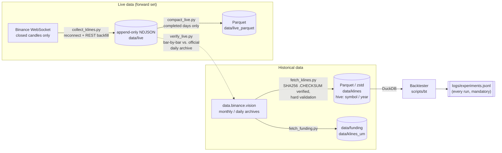

# marketdata-pipeline

A crypto market-data pipeline and backtesting framework, built as a **learning
project**.

This repository does **not** contain a profitable trading strategy and makes no
claim that one exists. The goal is the infrastructure around one: clean,
verified data, and a backtester that makes it hard to fool yourself.

Project notes in `DATA.md`, `GAPS.md`, `SPLITS.md` and in code comments are
written in German.

## Architecture



### Data pipeline

- **`fetch_klines.py`**: bulk-downloads spot klines from `data.binance.vision`.
  Each archive is checked against its published `.CHECKSUM` (SHA256). Parsing
  handles optional headers and ms/µs timestamps. Validation fails hard on
  duplicates, non-monotonic time, inconsistent OHLC, non-positive prices, NaNs,
  or more than 2 % missing bars, before anything is written. Only **completed
  UTC months** are stored. The running month is skipped and gets fetched from
  the monthly archive on the first run after the month has ended.
- **`fetch_funding.py`**: funding rates and USDT-M perpetual klines, using the
  same verification path.
- **`collect_klines.py`**: WebSocket collector. It writes **only closed
  candles**, since writing open candles would be lookahead bias. After every
  reconnect, and on restart, it backfills the gap via REST. It writes
  append-only NDJSON with `fsync`, and records each bar's origin (`ws` or
  `rest_backfill`). It can optionally send a heartbeat to a push monitor
  (`KUMA_PUSH_URL`).
- **`compact_live.py`**: compacts completed **UTC** days of NDJSON to Parquet.
  The running UTC day is never compacted. The NDJSON stays the source of
  truth; Parquet is derived and can be rebuilt.
- **`verify_live.py`**: compares a collected day bar by bar against Binance's
  official daily archive (missing bars, phantom bars, OHLCV differences).
- **`gaps.sql`**: DuckDB query that lists gaps in the historical store.
- **`fetch_dukascopy.py`**: historical tick data for XAUUSD, XAGUSD and EURUSD
  from Dukascopy, aggregated to 1-minute bars with **bid and ask** OHLC. See
  [Dukascopy (metals / FX)](#dukascopy-metals--fx) below.
- **`fetch_calendar.py`**: economic calendar (US / euro area) for the news
  blackout of a gold/silver bot. See
  [Economic calendar](#economic-calendar) below.
- **`export_fixture.py`**: exports a small slice of the kline store (default
  BTCUSDT 1m, 2024-01-01 to 2024-01-07) as a gzip CSV test fixture under
  `tests/fixtures/`. Meant to be run where the data lives; the output is then
  committed.

### Dukascopy (metals / FX)

`fetch_dukascopy.py` downloads hourly `.bi5` tick files from
`datafeed.dukascopy.com` (URL month is **0-based**, January = `00`; hours are
UTC). Each file is LZMA-compressed; an empty file means no ticks, a 404 means
missing. Records are 20 bytes big-endian (`>3I2f`): ms since the start of the
hour, ask, bid (integers), ask volume, bid volume (float32).

- **Assumption, to be verified:** price = integer / `POINT_DIVISOR`, with
  1000 for XAUUSD/XAGUSD and 100000 for EURUSD. A wrong divisor shifts prices
  by powers of ten, so every bar is checked against a coarse plausible range
  (XAUUSD 200–20000, XAGUSD 3–500, EURUSD 0.5–2.0) and the run aborts hard
  instead of writing wrong prices.
- Raw files are cached (month 1-based in the cache path), so the store can be
  rebuilt (`--rebuild`) without downloading again. 404s are cached as
  `HHh_ticks.404` marker files; delete a marker to request that hour again.
- Downloads are polite: generic User-Agent, retries with exponential backoff,
  `--workers` (default 4) and a pause between requests.
- Bars cover `[t, t+1min)`, labelled left, and exist only for minutes with
  ticks (no filling). Only **completed UTC months** are written; existing
  monthly files are not overwritten unless `--rebuild` is given.
- Hard validation before writing: duplicates, monotonic time, bid and ask OHLC
  consistency, prices > 0, NaNs, plausible range, crossed quotes
  (`ask_close < bid_close`, abort above 0.1 % of bars). Soft checks are only
  reported (log + JSON under `metals/reports/`): spread outliers (> 20x the
  monthly median), 1m mid jumps > 2 %, and minutes without ticks Mon–Fri on a
  coarse grid. There is deliberately **no hard gap limit** as for crypto:
  metals and FX have daily breaks and weekends. Classifying gaps as planned or
  unplanned is left to the consumer's trading calendar.
- Data root: `MARKETDATA_DATA_ROOT`, default `data/` in the repo (read only
  by this script and `fetch_calendar.py`).
- **License:** check Dukascopy's terms of use yourself. Do not redistribute
  or commit the data, raw or derived (`data/` is git-ignored).

### Economic calendar

`fetch_calendar.py` builds `calendar/events.parquet` (current state) plus a
snapshot per run under `calendar/snapshots/`, so moved dates stay traceable.
Schema and sources are in [DATA.md](DATA.md#wirtschaftskalender); settings in
`config/calendar.yaml` and `config/calendar_adhoc.csv`.

- **Sources**, each with its own parser: FRED `release/dates` (date only,
  time by rule, 08:30 ET; needs `FRED_API_KEY`), the Fed's FOMC calendar
  pages, the ECB Governing Council calendar, and a hand-kept ad-hoc CSV.
  Local times are converted with `zoneinfo`, never with a fixed offset.
- **Assumptions are guarded at run time.** The FRED release IDs come from
  memory: before use, the script fetches each release's name and aborts if it
  doesn't match. The FOMC and ECB parsers check meetings per year (FOMC 7–10,
  ECB 6–12) and fail instead of guessing.
- **Merge with the last state.** Same `event_id` → newest source wins; changed
  `ts_utc` → `rescheduled`; an event that disappears inside a source's newly
  fetched date range → `cancelled` (the row is kept).
- **Hard validation** (schema, UTC, no NaT, event_id vs. local date, impact
  vs. config, plausible local hour, at least 30 high-impact events per
  complete year from 2010, at most 10 newly cancelled high-impact events per
  run) on the merged table. If it fails, **nothing** is written, the old
  state stays, exit code 2.
- **Fault tolerance per source.** If one source fails (download, parser or
  plausibility check), its events from the last state stay **unchanged** (not
  cancelled), the other sources are updated and written as usual, and the run
  still exits non-zero (3; 4 for a config error such as the FRED name check),
  so systemd/alerting fires. A changed ECB page therefore can't block new
  CPI/NFP dates. On the very first run, a missing source is fine as long as
  the validation still passes. A JSON report (incl. failed sources) is
  written to `calendar/reports/` either way.
- **Cross-check** against the faireconomy weekly JSON is report-only: time
  differences over 5 minutes are listed, nothing is taken over, and failures
  of that source are not fatal.
- Not verified without network access when this was written: page structures
  of federalreserve.gov and ecb.europa.eu (the parsers were built against
  self-written fixtures), FRED release IDs (hence the name check), the FOMC
  press-conference rule before 2019, the FOMC times before 2013 (14:15, and
  12:30 statement / 14:15 press conference at press-conference meetings from
  2011-04-27; configurable periods in `fomc.time_rules`), ff titles. The ECB page covers only the
  current calendar, so ECB history builds up from the first run on.

### Backtester (`scripts/bt`)

- **Event-driven loop, long-only spot.** It is deliberately not vectorized: a
  bar-by-bar loop can't read data that doesn't exist yet. A signal computed on
  bar *t* is executed at the **open of *t+1***. This shift happens once, inside
  the engine, so no strategy can forget it.
- **Realistic costs.** Fee plus slippage are charged on the notional of every
  position change. The defaults are 10 bps fee (Binance spot taker) and 5 bps
  slippage.
- **Session-aware gap handling.** Every gap in the time grid starts a new
  session, and rolling windows never span a session boundary. Positions *are*
  held through exchange outages, because exiting early would require knowing
  the outage was coming. Trades that span a gap are flagged (`spans_gap`), and
  their P&L share is reported (`gap_pnl_share`). See [GAPS.md](GAPS.md).
- **Mandatory experiment log.** Every run, including failed ones, is appended
  to `logs/experiments.jsonl` with its config hash, metrics and a free-text
  note. Logging can't be turned off.
- **Random-entry null baseline.** Each strategy is compared with 1000 runs that
  use random entries but the same number of trades and the same holding-period
  distribution. The run reports the strategy's percentile in that
  distribution.
- **Locked holdout.** The split boundaries are hard-coded in `bt/data.py`.
  Loading the holdout requires an explicit `--i-am-done`, and every use is
  counted in `logs/holdout_uses.jsonl`. `--from` / `--to` can only *narrow* a
  split, never extend it into the holdout. See [SPLITS.md](SPLITS.md).
- **Metrics.** Sharpe and Sortino are computed on *daily* returns, not minute
  returns. Sortino uses the downside deviation `sqrt(mean(min(r, 0)^2))` over
  all days. Annualization defaults to 365 periods per year (crypto, 24/7);
  `summarize(res, periods_per_year=252)` is meant for assets with weekends,
  together with a daily series without weekend days. The run also reports drawdown, Calmar, exposure, costs paid, win
  rate, profit factor, and how much of the gross profit the top 5 trades
  contributed.

## Control tests

Before any strategy idea is worth looking at, the engine has to pass three
controls. Values are taken from `logs/experiments.jsonl`. All three runs use
BTCUSDT on 1h bars over the exploration split (2019-01-01 to 2023-12-31, about
5.0 years), with 10 bps fee and 5 bps slippage.

| Control | Purpose | Total return | CAGR | Sharpe (daily) | Max DD | Exposure | Trades |
|---|---|---:|---:|---:|---:|---:|---:|
| `buy_and_hold` | Reference point | +1,041 % | +62.8 % | 1.06 | −77.2 % | 100 % | 0¹ |
| `always_flat` | Null case | 0.0 % | 0.0 % | 0.00 | 0.0 % | 0 % | 0 |
| `oracle` | Engine check (looks ahead) | ≈ 7.1 × 10²⁵ ײ | ≈ 1.5 × 10⁷ % | 15.29 | −11.3 % | 51.0 % | 11,778 |

¹ The single buy is never closed, so no completed trade is logged. Costs paid
were 0.15 % of initial capital (one entry).
² The total return is a multiple of initial capital, not a percentage.

**Why `oracle` has to be absurdly high.** The oracle is long during a bar
exactly when that bar's open-to-open move is positive. In other words, it knows
the future. Compounding thousands of guaranteed winning bars must produce
astronomical numbers. If it doesn't, the engine is broken: signals are executed
late, costs are double-counted, or equity is computed incorrectly. A believable
oracle result would be the alarming outcome.

The details also tell you something:

- The win rate is 64.3 %, not 100 %, because the round trip costs about 30 bps.
  Moves the oracle "correctly" predicts but that are smaller than the costs
  become net losers. This confirms that costs are applied.
- Max drawdown is not zero, because equity is marked at the close while the
  oracle only knows open-to-open moves.
- `always_flat` must return exactly zero with zero cost, and it does.

One further reference run in the log isolates 2022 with buy-and-hold: −64.6 %,
Sharpe −1.34, max DD −67.4 %. That bear market sits inside the exploration
period.

## Methodology / avoiding self-deception

- **Overfitting.** Any rule you tune long enough on the same data will look
  good. The defence is structural, not willpower. The data is split into
  **exploration** (2019-01-01 to 2023-12-31, where all research happens),
  **holdout** (2024-01-01 to 2026-08-20, used *once*, for *one* final
  strategy), and **forward** (live collector data from 2026-08-21, the only
  data that is out of sample by construction). Holdout and forward don't
  overlap.
  The holdout sits at the *end* of the series on purpose: markets are not
  stationary, and the question is whether a rule holds in the most recent
  regime.
- **Holdout discipline.** After the first use, the holdout no longer counts as
  independent evidence. The use counter makes it visible if that has happened.
  Holdout untouched so far: logs/holdout_uses.jsonl is created on first access
  and will be committed once it exists.
- **Null baseline instead of "beats buy-and-hold".** Beating buy-and-hold says
  little when exposure and timing differ. The random-entry baseline holds
  everything constant except *when* you enter. A strategy below the 95th
  percentile of that distribution has found nothing.
- **Multiple testing.** The best of *N* variants is biased upward, and the bias
  grows with *N*. That is why every run is logged and the runner prints the
  current count after each run. Past 20 logged variants, landing in the 95th
  percentile of the null distribution means nothing; you'd expect it from
  chance. The current log has **4 runs**, and all of them are controls or
  reference runs (buy-and-hold, flat, oracle, buy-and-hold 2022). **No strategy
  hypothesis has been tested yet.**
- **Gaps are not noise.** BTCUSDT and ETHUSDT have the same 22 gaps, which
  points to outages on the exchange side rather than download errors. Six of
  them are unplanned outages of up to 354 minutes, and no one could trade
  during them. A backtest that silently interpolates over them overstates what
  you could actually have traded. See [GAPS.md](GAPS.md).

## Quick start

Requires Python 3.10+.

```bash
python -m venv .venv && source .venv/bin/activate
pip install -r requirements.txt

# historical data (written to data/klines)
python scripts/fetch_klines.py --symbol BTCUSDT --interval 1m --start 2019-01

# control runs
python scripts/run_backtest.py --strategy buy_and_hold --tf 1h --no-baseline --note "reference"
python scripts/run_backtest.py --strategy oracle       --tf 1h --no-baseline --note "engine check"

# a real (example) strategy, with the random-entry baseline
python scripts/run_backtest.py --strategy sma_cross --tf 15min \
    --param fast=20 --param slow=100 --note "why am I running this?"

# live collector + verification
python scripts/collect_klines.py --symbols BTCUSDT ETHUSDT --interval 1m
python scripts/compact_live.py --symbol BTCUSDT
python scripts/verify_live.py  --symbol BTCUSDT --date 2026-08-21

# economic calendar (FRED_API_KEY from /etc/marketdata.env or the shell)
python scripts/fetch_calendar.py --start-year 2003 --dry-run -v
python scripts/fetch_calendar.py --sources fomc,ecb,adhoc,ff   # without FRED (fails validation on an empty store)

# metals / FX from Dukascopy (written to data/metals, raw cache in data/raw/dukascopy)
python scripts/fetch_dukascopy.py --symbol XAUUSD --start 2024-01 --workers 4

# test fixture from the local kline store
python scripts/export_fixture.py      # -> tests/fixtures/BTCUSDT-1m-2024-01-01_07.csv.gz
```

All data is written below `data/`, which is git-ignored. All timestamps are
UTC.

### Tests

The tests use synthetic fixtures and need no downloaded data and no network.

```bash
pip install -r requirements-dev.txt
python -m pytest tests
```

## Directory layout

```
.
├── scripts/
│   ├── fetch_klines.py      historical spot klines (checksum-verified)
│   ├── fetch_funding.py     funding rates + perp klines
│   ├── fetch_dukascopy.py   Dukascopy ticks -> 1m bid/ask bars (metals, FX)
│   ├── fetch_calendar.py    economic calendar (FRED, FOMC, ECB, ad hoc)
│   ├── export_fixture.py    kline slice -> tests/fixtures/*.csv.gz
│   ├── collect_klines.py    WebSocket live collector
│   ├── compact_live.py      NDJSON -> Parquet (completed days)
│   ├── verify_live.py       live data vs. official archive
│   ├── run_backtest.py      backtest runner (logs every run)
│   ├── gaps.sql             gap listing (DuckDB)
│   └── bt/
│       ├── data.py          loading, resampling, sessions, split guard
│       ├── engine.py        event-driven engine, costs
│       ├── metrics.py       metrics on daily returns
│       ├── baseline.py      random-entry null distribution
│       └── strategies.py    controls + example strategy
├── tests/                   pytest, synthetic fixtures only
│   └── fixtures/            small exported data slices (export_fixture.py)
├── config/                  calendar.yaml, calendar_adhoc.csv
├── systemd/                 systemd units (see Deployment)
├── logs/experiments.jsonl   experiment log (committed)
├── data/                    not committed
│   ├── klines/              spot klines, symbol=/year=
│   ├── raw/dukascopy/       raw .bi5 cache, SYM/YYYY/MM/DD (month 1-based)
│   ├── raw/fomc/            cached FOMC historical pages
│   ├── calendar/            events.parquet, snapshots/, reports/
│   └── metals/
│       ├── source=dukascopy/symbol=/year=/SYM-1m-YYYY-MM.parquet
│       └── reports/         validation report per month (JSON)
├── DATA.md                  dataset inventory
├── GAPS.md                  gap analysis
└── SPLITS.md                frozen data splits
```

## Deployment

The pipeline runs in an LXC container on UTC, under systemd. It is installed in
`/opt/marketdata`, with a venv at `/opt/marketdata/.venv`, as user `mkt`. The
units only get write access to `/opt/marketdata/data`.

| Unit | Status |
|---|---|
| `marketdata-collector.service` | **Running in production.** The file in `systemd/` is the deployed unit, unchanged. It reads `/etc/marketdata.env`; template: [`.env.example`](.env.example). |
| `marketdata-compact.service` + `.timer` | **Deployed and running.** Compacts completed UTC days, daily at 00:30 UTC. `Persistent=true` catches up on runs missed while the container was down. |
| `marketdata-calendar.service` + `.timer` | **New, not deployed yet.** Economic calendar, daily at 05:10 UTC, `Persistent=true`. Reads `FRED_API_KEY` from `/etc/marketdata.env` (`EnvironmentFile=-`, optional). Exits non-zero if a source or the validation fails (a failed source keeps its old events, the rest is still written). Needs `pyyaml` (`pip install -r requirements.txt`). |

There is no timer for `fetch_klines.py`; historical data is fetched manually.

The collector unit loads `/etc/marketdata.env` via `EnvironmentFile=` without
a `-` prefix, so the file has to exist; it may be empty. The collector's
setting `KUMA_PUSH_URL` (Uptime Kuma push heartbeat) is optional. The calendar
unit reads `FRED_API_KEY` from the same file; without it the FRED source fails
and the run exits non-zero. Copy [`.env.example`](.env.example) there and fill
it in.

Installing the units on a new host:

```bash
sudo cp systemd/*.service systemd/*.timer /etc/systemd/system/
sudo systemctl daemon-reload
sudo systemctl start marketdata-compact.service      # one manual run first, check the log
journalctl -u marketdata-compact.service -n 50
sudo systemctl enable --now marketdata-collector.service marketdata-compact.timer
# calendar: one manual run first, then the timer
sudo systemctl start marketdata-calendar.service && journalctl -u marketdata-calendar.service -n 50
sudo systemctl enable --now marketdata-calendar.timer
```

## Known issues / changelog

- **2026-11, metrics: Sortino formula.** Sortino used the standard deviation
  of the negative daily returns only. It now uses the downside deviation over
  all days. Sortino values logged in `logs/experiments.jsonl` before this
  change were computed with the old formula; the log is append-only and was
  not rewritten.

- **2026-10, data repair: partial month 2026-08.** A bug in `fetch_klines.py`
  stored the then-running month 2026-08 as a regular monthly file containing
  only 1–19 August, and later runs never replaced it. Fixed: only completed
  UTC months are written now. The affected files were deleted and reloaded
  from the official monthly archives.

## Further documentation

- [DATA.md](DATA.md): dataset inventory and live-collector verification
- [GAPS.md](GAPS.md): gaps in the BTCUSDT and ETHUSDT history and how the backtester handles them
- [SPLITS.md](SPLITS.md): frozen exploration / holdout / forward splits

## License

MIT, see [LICENSE](LICENSE).
